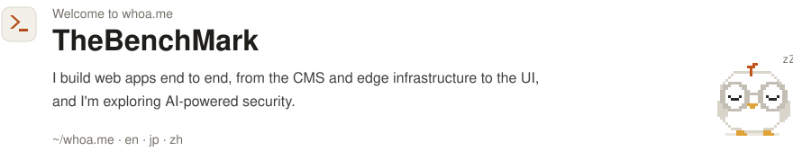

<picture><source media="(prefers-color-scheme: dark)" srcset="./assets/header-dark.svg"></picture>

 

<picture><source media="(prefers-color-scheme: dark)" srcset="./assets/q-build-dark.svg"></picture>

<picture><source media="(prefers-color-scheme: dark)" srcset="./assets/c-build-dark.svg"></picture>

 &nbsp;**[justitia](https://github.com/0xCAFEBABEx0/justitia)** — ⚖️ Japanese laws as of any date, with side-by-side diffs between two dates and full-text search. <code>v2026.11.1</code> 
 &nbsp;**[athena](https://github.com/0xCAFEBABEx0/athena)** — 🚀 This site: a blog and portfolio run from Payload CMS, served by Astro on Vercel, in three languages. <code>v1.7.0</code> 
 &nbsp;**chronos** — 🦕 A modern bilingual dinosaur encyclopedia built on Cloudflare, powered by Astro, Hono, D1, R2 and Pagefind. <code>private</code>

<a href="https://whoa.me/builds">All builds</a>

 

<picture><source media="(prefers-color-scheme: dark)" srcset="./assets/q-stack-dark.svg"></picture>

<picture><source media="(prefers-color-scheme: dark)" srcset="./assets/c-stack-dark.svg"></picture>

**AI** — Claude, ChatGPT, Grok, Muse 
**Code** — Claude Code, Cursor, Devin, Codex, CodeRabbit · TypeScript, Python · Astro, Svelte, Hono 
**Infrastructure** — Cloudflare, Vercel, AWS, Supabase, Neon, Tailscale

<a href="https://whoa.me/stacks">All stacks</a>

 

<picture><source media="(prefers-color-scheme: dark)" srcset="./assets/q-about-dark.svg"></picture>

<picture><source media="(prefers-color-scheme: dark)" srcset="./assets/c-about-dark.svg"></picture>

By day I lead market data products at **Nikkei Inc.** Outside work I build web apps end to end with AI agents, and I'm exploring how AI can help with security. I came into this work from planning and production, taught myself programming along the way, and now build my own prototypes.

<a href="https://whoa.me/about">More about me</a>

 

<a href="https://whoa.me"><picture><source media="(prefers-color-scheme: dark)" srcset="./assets/askbar-dark.svg"></picture></a>
